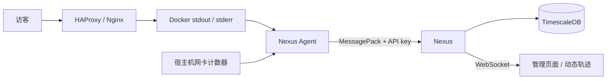

# Nexus

Nexus 是用于自托管节点的实时访问与网络流量观测平台。服务端展示访客到节点的动态轨迹、世界地图与地球视图、访问统计、在线状态和流量配额；Nexus Agent 从 Docker 容器访问日志及宿主机网卡计数器采集数据。

| 组件 | Docker 镜像 | 程序版本 |
| --- | --- | --- |
| Nexus 服务端 | [`utoptop/nexus:1.0`](https://hub.docker.com/r/utoptop/nexus) | 1.0.0 |
| Nexus Agent | [`utoptop/nexus-agent:1.0`](https://hub.docker.com/r/utoptop/nexus-agent) | 1.0.0 |

镜像提供 `linux/amd64` 和 `linux/arm64`。源码仓库：[utoptop/nexus](https://github.com/utoptop/nexus)。

> `:1.0` 已重新发布为 TOML 配置文件版，程序版本仍为 `1.0.0`。使用旧环境变量版的实例，请先按[迁移说明](docs/MIGRATION.md)准备配置并保留原数据，再拉取同名镜像；仅执行 restart 不会更新镜像。

## 功能

- 真实访问事件驱动的地图轨迹、访客亮点、节点活动和历史回放，适配桌面与手机。
- 节点心跳在线判断、收发速度、累计流量、月配额和重置日期配置。
- 本地账号、管理员/观察者权限、Google OIDC、会话撤销与 CSRF 防护。
- 独立 TOML 配置文件，以及可显式开启/关闭的 Cloudflare Turnstile 本地登录验证。
- `auth.public_base_url` 与 `auth.allowed_origins` 支持源站域名和代理域名同时访问。
- Docker Unix Socket 原生日志采集，支持 `TRACK_L7`、Nginx common/combined 和 HAProxy HTTP 日志。
- Agent 使用 SQLite 持久队列、stdout/stderr 独立游标、故障退避与有界背压。
- PostgreSQL/TimescaleDB 存储，支持本地 GeoLite2 City IP 地理库。



## 服务端快速部署

以下步骤用于**全新安装**。已有 IP Logger / logger-agent 部署先阅读[迁移说明](docs/MIGRATION.md)，继续使用原数据库与持久卷。

要求：Linux、Docker Engine、Docker Compose v2，以及可用的 HTTPS 反向代理。数据库磁盘用量取决于访问量与保留天数，建议先观察实际负载再调整预算。

```bash
git clone https://github.com/utoptop/nexus.git
cd nexus
cp config/nexus.toml.example config/nexus.toml
openssl rand -hex 24 > config/postgres-password
chmod 700 config
chmod 644 config/nexus.toml config/postgres-password
```

编辑 `config/nexus.toml` 的对应配置段（不要重复添加同名段）：

```toml
[auth]
admin_path = "/admin"
public_base_url = "https://nexus.example.com"
allowed_origins = []
initial_username = "admin"
initial_password = "替换为至少12个字符的独立管理密码"

[turnstile]
enabled = false
site_key = ""
secret_key = ""
```

`public_base_url` 不带 `/admin`。多个入口写入 `allowed_origins = ["https://proxy.example.com"]`；各域名需分别登录。需要人机验证时，把 `enabled` 改为 `true` 并填写 Cloudflare Turnstile 的两把密钥；缺少任意一把会拒绝启动。

```bash
docker compose pull nexus
docker compose run --rm --no-deps nexus --config /etc/nexus/nexus.toml --check-config
docker compose up -d --no-build
docker compose logs --tail=100 nexus
```

默认发布 `127.0.0.1:3001 → 容器 3000`，宿主反向代理连接 `http://127.0.0.1:3001`。配置好 HTTPS 后打开 `https://nexus.example.com/admin`，登录并创建探针 API key。应用不读取 `.env` 或旧环境变量。数据库镜像内部使用固定的初始化环境项，密码通过文件传入。

- [完整服务端部署与参数](docs/DEPLOYMENT.md)
- [Nginx 示例](deploy/nginx.conf) / [HAProxy 示例](deploy/haproxy.cfg)
- [Google 登录、账号与多域名](docs/AUTHENTICATION.md)

## 部署探针

在每个需要监控的 Linux Docker 节点上，使用 `agent/` 内的 Compose 和配置：

```bash
cd agent
cp config/nexus-agent.toml.example config/nexus-agent.toml
chmod 700 config
```

编辑 `config/nexus-agent.toml`：

```toml
server_url = "https://nexus.example.com/api/track_batch"
auth_token = "替换为后台生成的API密钥"
node_ip = "203.0.113.10" # 换为节点真实公网 IP
monitor_containers = ["auto"]
network_interfaces = []
```

```bash
docker compose pull nexus-agent
docker compose run --rm --no-deps nexus-agent --config /etc/nexus-agent/nexus-agent.toml --check-config
docker compose up -d --no-build
docker compose logs -f nexus-agent
```

`auto` 仅匹配名称或镜像含 `nginx` / `haproxy` 的运行容器；其他名称写成 `monitor_containers = ["proxy-main", "web-gateway"]`。日志须写到 Docker 可读取的 stdout/stderr。

**节点在线、有网速，不代表已经采集到访问事件。** 轨迹还需要支持的日志、有效客户端 IP，以及成功建立管理路径下的 WebSocket 连接。

详见[探针部署、日志格式与恢复机制](docs/AGENT.md)。

## 源码结构

```text
server/                 Nexus Rust 服务端、页面和回归测试
agent/                  Nexus Agent、独立 Compose 和采集测试
deploy/                 Nginx / HAProxy 配置示例
docs/                   部署、迁移、身份管理、开发和故障排查
docker-compose.yaml     全新服务端安装（应用 + TimescaleDB）
config/                 TOML 模板与 PostgreSQL 配置
agent/config/           探针 TOML 模板
```

## 升级与数据

新安装的数据位于项目的 `pgdata/`；探针状态位于 `nexus-agent_agent-data` Docker 卷。先备份数据库，再升级应用镜像；普通应用升级不需要重新初始化数据库。不要用 `down -v` 或删除持久目录来处理登录、网络或轨迹问题。

```bash
docker compose pull nexus
docker compose up -d --no-deps --no-build --force-recreate nexus
```

配置在启动时读取；修改 TOML 后重新创建容器，以兼容编辑器原子替换文件的行为。单纯修改配置不需要重新构建镜像。数据库使用 PG17 系列；数据库版本升级需要单独规划，不能直接将旧 PG 数据目录挂载给不同主版本。

## 运行边界

- Agent 的可靠队列不能代替服务端幂等确认。当前访问批次按服务端接收时间记账，响应丢失时重试可能重复，服务端确认与访问日志落盘之间仍有窗口。
- 网速字段兼容旧的 `speed × 2` 累计契约；断网补报时可能有尖峰，不能视为精确的瞬时带宽测量。
- Docker 日志保留时间决定断网后可补读的上限；写在容器普通文件或外部 syslog 的日志不会自动被 Socket 采集。
- 当前实时广播位于单个服务端进程。多个服务端副本需要额外的共享事件总线，不能仅靠负载均衡实现全节点实时广播。
- 地图、IP 查询和可选 Google 登录涉及第三方服务。GeoLite2 数据库需要自行合法取得，不包含在镜像或仓库中。

[故障排查](docs/TROUBLESHOOTING.md) · [构建与测试](docs/DEVELOPMENT.md) · [1.0 变更](CHANGELOG.md)
